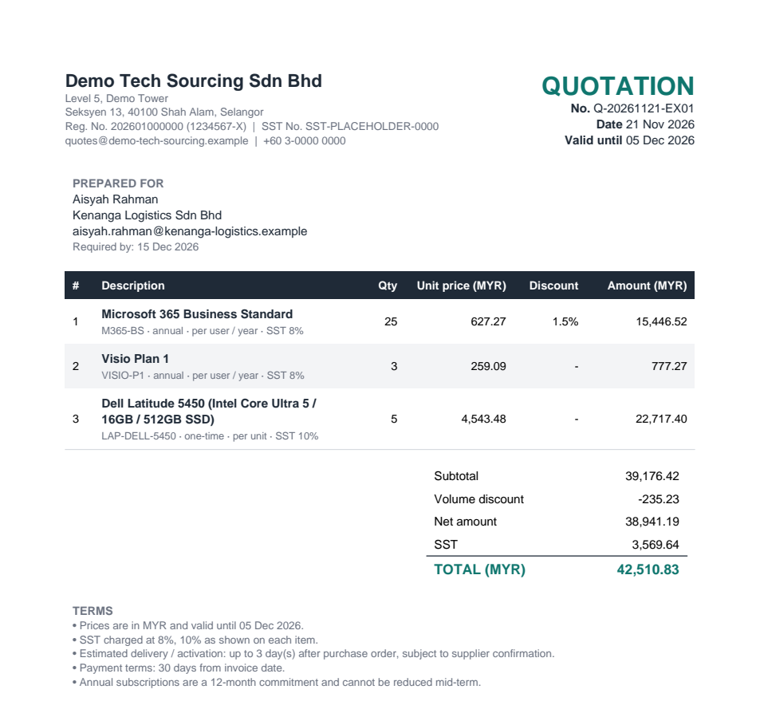
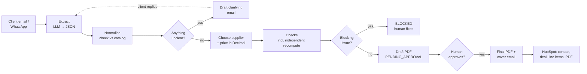

# Request-to-Quote Agent

[](https://github.com/najahtasfiazumana-byte/quote-agent/actions/workflows/tests.yml)

**A messy client email goes in. An accurate, approved PDF quote and a HubSpot deal come out.**

An AI agent for IT sourcing teams that resell software licences, AI tools and hardware. It reads a
client's request (email or WhatsApp, English or Bahasa Malaysia), works out exactly what they need,
asks the client when something is unclear instead of guessing, picks the best supplier, prices the
quote, checks every number twice, waits for a human to approve it, and then logs the deal in the CRM.

> **The core rule: the LLM reads, code decides.**
> The language model only turns unstructured text into structured data and polishes email wording.
> Every price, discount, tax amount and total is calculated with Python `Decimal` and then
> recalculated independently before a person ever sees the quote. Every quote carries the company's
> name, so a wrong number isn't an option.

Runs **100% free** on the Gemini free tier or a local model through Ollama, can switch to Claude, and
has an offline mode that needs no API key at all.



---

## Contents

- [How it works](#how-it-works)
- [Quick start (2 minutes, no API key)](#quick-start-2-minutes-no-api-key)
- [Use a real LLM (free)](#use-a-real-llm-free)
- [Commands](#commands)
- [Review screen (Streamlit)](#review-screen-streamlit)
- [Accuracy safeguards](#accuracy-safeguards)
- [What the LLM does vs. what code does](#what-the-llm-does-vs-what-code-does)
- [Project structure](#project-structure)
- [Configuration and data](#configuration-and-data)
- [Tests](#tests)
- [Limitations and roadmap](#limitations-and-roadmap)
- [Docs](#docs)

---

## How it works



Each quote gets its own folder, `outputs/<quote_no>/`, holding everything a reviewer or an auditor needs:

| File | What it is |
|---|---|
| `request.txt` | The original request, plus the client's replies |
| `extraction.json` | What the agent understood (products, quantities, terms, deadline) |
| `clarification_email.txt` | Questions to send the client, if anything was unclear |
| `review.md` | One-page summary for the approver: items, pricing, margin, checks |
| `internal_costing.csv` | **Internal only**: supplier, cost, margin, and every supplier option with the reason it was or wasn't chosen |
| `quote_DRAFT.pdf` | Client quote with a DRAFT watermark, created before approval |
| `<quote_no>.pdf` | Final client quote, created after approval |
| `quote_email.txt` | Cover email to send with the PDF |
| `hubspot_requests.json` | Every CRM API call made (or that would be made, in dry-run mode) |
| `audit.jsonl` | Timestamped log of every step, including who approved |
| `state.json` | Full machine-readable state, so a quote can be approved or continued later |

You can browse real sample outputs for all five sample requests in [`examples/`](examples/).

---

## Quick start (2 minutes, no API key)

Requires Python 3.10+.

```bash
git clone https://github.com/najahtasfiazumana-byte/quote-agent.git
cd quote-agent

python -m venv .venv
source .venv/bin/activate          # Windows: .venv\Scripts\activate
# or with Anaconda: conda create -n quote python=3.11 -y && conda activate quote

pip install -e ".[dev,ui]"

quote-agent demo                   # runs every sample request offline
```

```
01_clear_request.txt  -> PENDING_APPROVAL  Q-20261121-894D  total MYR 42,510.83
02_messy_request.txt  -> PENDING_APPROVAL  Q-20261121-4A74  total MYR 42,510.83
03_rush_order.txt     -> PENDING_APPROVAL  Q-20261121-058A  total MYR 186,903.75
04_unknown_product.txt-> PENDING_APPROVAL  Q-20261121-4CF4  total MYR 6,244.39
05_bahasa_mix.txt     -> PENDING_APPROVAL  Q-20261121-8705  total MYR 18,947.72
```

`demo` uses the **mock** provider, a simple keyword parser that needs no API key and exists so the
whole pipeline can be run and tested for free. For real, messy requests, use an LLM (next section).

---

## Use a real LLM (free)

```bash
cp .env.example .env
```

| Provider | Cost | Setup |
|---|---|---|
| **Gemini** (default) | Free tier | Create a key at <https://aistudio.google.com/apikey> and set `GEMINI_API_KEY` |
| **Claude** | Small new-account credit, then pay-as-you-go | Create a key at <https://platform.claude.com> and set `ANTHROPIC_API_KEY` |
| **Ollama** | Free, runs on your laptop | Install from <https://ollama.com>, run `ollama pull llama3.1`, then set `QUOTE_AGENT_PROVIDER=ollama` |
| **mock** | Free, offline | Nothing to set up |

Switching provider is one flag: `--provider claude`. The rest of the system doesn't change, because
providers sit behind one small interface ([`llm.py`](src/quote_agent/llm.py)) built on plain HTTP
(`requests`), with no vendor SDKs.

> Free-tier data may be used by the provider to improve their models. The sample data is
> fictional. Don't send real client data through a free tier.

---

## Commands

```bash
# 1. A new request arrives
quote-agent run data/requests/02_messy_request.txt
#    -> NEEDS_CLARIFICATION: send outputs/Q-.../clarification_email.txt to the client

# 2. The client replies: continue the same quote (same quote number)
quote-agent reply outputs/Q-20261121-XXXX data/requests/02_followup_reply.txt
#    -> PENDING_APPROVAL: review review.md and quote_DRAFT.pdf

# 3. A human approves: final PDF, cover email, HubSpot deal
quote-agent approve outputs/Q-20261121-XXXX --approver "Najah"

# ...or rejects
quote-agent reject outputs/Q-20261121-XXXX --approver "Najah" --reason "client went with another vendor"
```

Useful options:

| Option | Meaning |
|---|---|
| `--provider gemini\|claude\|ollama\|mock` | Choose the LLM (put it before the command, e.g. `quote-agent --provider claude run ...`) |
| `--today 2026-11-21` | Pretend it's a given date, so relative deadlines like "end of month" can be replayed |
| `run ... --followup reply.txt` | Process a request and the client's reply in one go |
| `run ... --yes --approver NAME` | Auto-approve if there are no blocking checks (blocking checks always stop it) |
| `--crm dry-run\|live\|auto` | `auto` (default) = live when `HUBSPOT_TOKEN` is set, otherwise dry-run |
| `run - ` | Read the request from stdin, e.g. `pbpaste \| quote-agent run -` |

When run in a terminal, `run` asks *"Approve and send this quote?"* at the end. Use `--no-prompt` to skip that.

---

## Review screen (Streamlit)

```bash
streamlit run app.py
```

Paste a request (or load a sample) to see what the agent extracted, the questions it would ask, the
pricing table with margins, and every check. You can then approve with one click, which produces the
final PDF and the HubSpot push. This is the human-in-the-loop step, made visual.

**Put it online for free** with [Streamlit Community Cloud](https://share.streamlit.io): choose *Create app*,
pick this repo, set the main file to `app.py`, and in *Advanced settings → Secrets* add:

```toml
QUOTE_AGENT_PROVIDER = "gemini"
GEMINI_API_KEY = "your-key"
```

Leave the secrets empty to run the public demo in offline mock mode. Don't put a live `HUBSPOT_TOKEN`
on a public app. Files written to `outputs/` on the cloud are temporary.

---

## Accuracy safeguards

| Risk | Safeguard |
|---|---|
| The LLM guesses a product plan, billing term or laptop model | Code decides what's missing ([`clarify.py`](src/quote_agent/clarify.py)), and the agent asks the client instead of guessing |
| The LLM invents a SKU | Every SKU is checked against `catalog.csv`. Unknown SKUs are dropped and logged ([`extract.py`](src/quote_agent/extract.py) `normalise()`) |
| The LLM returns broken JSON | Pydantic validation, plus one retry that includes the exact validation error |
| Arithmetic errors | No LLM maths. `Decimal`, `ROUND_HALF_UP` at 2 dp, at the same points a person would round |
| A bug in the pricing code | **Independent recompute**: [`checks.py`](src/quote_agent/checks.py) recalculates every line with exact fractions, and any 1-sen difference blocks the quote |
| An expired supplier price | Expired price lists are skipped automatically, and you're warned if a price expires before the quote does |
| Promising a date we can't meet | Supplier lead time is compared with the client's deadline. On-time suppliers are preferred, otherwise you get a `DEADLINE_RISK` warning |
| Quoting stock that doesn't exist | Stock and minimum order quantities are checked for every supplier |
| Selling below margin | `MARGIN_BELOW_FLOOR` blocks approval |
| A big deal sent without oversight | `MANAGER_APPROVAL` warning above a configurable threshold |
| A wrong number in the cover email | The LLM may only reword. Any number in its draft that isn't in the facts it was given means the draft is discarded and a template is used ([`writer.py`](src/quote_agent/writer.py)) |
| Supplier costs leaking to the client | Suppliers and costs appear only in `internal_costing.csv`, never on the PDF (covered by a test) |
| A quote sent without review | Nothing is final until a named person approves. Blocked quotes can't be approved, and the approver's name goes in `audit.jsonl` |

---

## What the LLM does vs. what code does

| Step | LLM | Code |
|---|:---:|:---:|
| Read the request, map wording to catalog products | ✅ | |
| Validate SKUs, fill in single-option fields | | ✅ |
| Decide what needs to be asked | | ✅ |
| Phrase questions and emails in the client's language | ✅ | ✅ (number guard + template fallback) |
| Choose the supplier | | ✅ |
| Prices, discounts, tax, totals | | ✅ |
| Checks | | ✅ |
| Approval | | 👤 human |
| CRM update | | ✅ |

---

## Project structure

```
quote-agent/
├── app.py                     Streamlit review screen
├── requirements.txt           dependencies for Streamlit Community Cloud
├── config.yaml                margins, discounts, tax, company details, CRM stage
├── data/
│   ├── catalog.csv            products, families, billing terms, aliases
│   ├── suppliers/*.csv        one price list per (fictional) distributor
│   └── requests/*.txt         sample client requests
├── src/quote_agent/
│   ├── llm.py                 Gemini / Claude / Ollama / mock behind one interface
│   ├── extract.py             LLM + offline extractors, catalog normalisation
│   ├── clarify.py             rules for what must be asked
│   ├── pricing.py             supplier choice + Decimal maths
│   ├── checks.py              accuracy checks incl. independent recompute
│   ├── writer.py              client emails with a number guard
│   ├── pdf.py                 ReportLab quote PDF
│   ├── hubspot.py             contact, deal, line items, PDF attachment
│   ├── pipeline.py            orchestration, state, audit log
│   ├── models.py              Pydantic data models
│   ├── config.py / catalog.py loaders
│   └── cli.py                 `quote-agent` command
├── tests/                     42 offline tests
├── examples/                  committed sample outputs
├── scripts/build_examples.py  regenerates examples/
└── docs/                      architecture, setup, pain-point log, demo script
```

---

## Configuration and data

- **[`config.yaml`](config.yaml)** holds the target margin per category, the margin floor, volume
  discount tiers, tax rates, quote validity, the manager-approval threshold, company details and the
  HubSpot deal stage. Business rules change here, not in code.
- **Tax rates are placeholders.** Confirm the correct treatment for each product type with finance
  before using this with real quotes.
- **[`data/catalog.csv`](data/catalog.csv)** lists products. `family` groups interchangeable options
  (e.g. the three Microsoft 365 plans), and that's how the agent knows when to ask "which one?".
- **[`data/suppliers/`](data/suppliers/)** has one CSV per distributor: `sku, billing_term,
  unit_cost, stock, lead_time_days, min_qty, valid_until`. Add a distributor by adding a file.

All distributors, prices, stock levels and clients in this repo are **fictional**. Product names are
used only to make the scenarios realistic.

---

## Tests

```bash
pytest
```

There are 42 tests and none of them need network access or API keys. They cover the hand-checked
pricing example, rounding, supplier selection rules, every check (including a tampered total being
caught), extraction on all sample requests, LLM retry behaviour with a scripted model, the email
number guard, the full run → reply → approve flow, PDF content, and the HubSpot payloads. GitHub
Actions runs them on every push.

---

## Limitations and roadmap

Being honest about what this is and isn't:

- The **mock extractor** is a keyword parser for tests and offline demos. Real-world messages need an
  LLM provider.
- Price lists are **CSV files**. Next step: read them from Google Sheets or a distributor API.
- Intake is **a file or stdin**. Next step: an n8n or Gmail trigger, and WhatsApp through the Business API.
- HubSpot gets **line items and a PDF attached to the deal**. Next step: native HubSpot Quotes, and
  updating the deal stage when the client accepts.
- After acceptance: generate supplier purchase orders, track delivery and provisioning, and chase
  payment. This is the "follow-through" half of the sourcing flow.
- Renewals: every annual line is a renewal date. Feed them into a renewal and upsell radar.

---

## Docs

- [docs/ARCHITECTURE.md](docs/ARCHITECTURE.md): design, state machine, data model, and why things are built this way
- [docs/SETUP.md](docs/SETUP.md): free setup for Gemini, Claude, Ollama and HubSpot
- [docs/PAIN_POINT_LOG.md](docs/PAIN_POINT_LOG.md): doing it by hand first, then deciding what to automate
- [docs/DEMO_SCRIPT.md](docs/DEMO_SCRIPT.md): a 5-minute walkthrough

## License

MIT © Najah Tasfia Zumana
