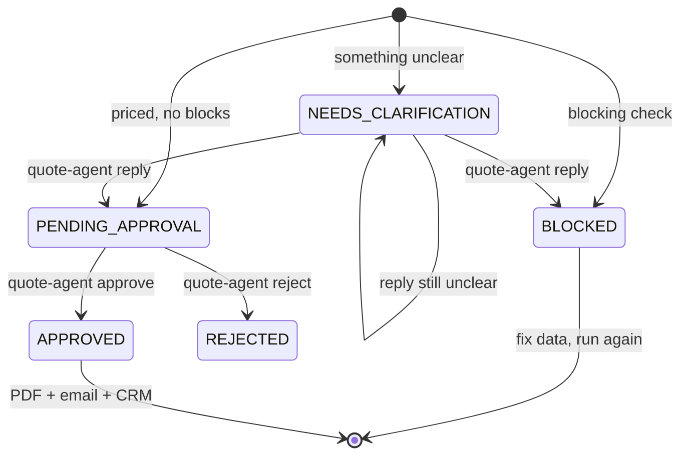

# Architecture

## Design principles

1. **The LLM reads, code decides.** Models are excellent at turning *"M365 for 25 staff, 3 of them
   need Visio"* into structured data, and unreliable at arithmetic and business rules. So the model's
   job ends at structured extraction (and polishing email wording). Everything that affects money is
   deterministic Python.
2. **Ask, don't guess.** If the client didn't specify a plan, billing term or model, the agent asks.
   A wrong guess costs a re-quote and some trust.
3. **Two independent calculations.** Pricing uses `Decimal`. The checks recompute everything with
   `fractions.Fraction` in separate code. They must agree to the sen.
4. **A human signs every quote.** The agent prepares, a named person approves, and the log records who.
5. **Every step leaves a file.** A reviewer, a new teammate or an auditor can open the quote's folder
   and see what was asked, what was understood, which suppliers were considered, and why.
6. **Provider-agnostic.** Gemini, Claude, Ollama or no model at all, behind one interface, using
   plain HTTP with no SDK lock-in.

## Flow and states



## Modules

| Module | Responsibility | Uses LLM? |
|---|---|:---:|
| `llm.py` | `complete_text` / `complete_json` for Gemini, Claude, Ollama; retries on 429/5xx; tolerant JSON parsing | yes |
| `extract.py` | `LLMExtractor` (prompt + Pydantic validation + one corrective retry), `RuleBasedExtractor` (offline), `normalise()` (catalog is the source of truth) | yes |
| `clarify.py` | Rules: missing SKU in a multi-option family, missing quantity, missing or invalid billing term | no |
| `pricing.py` | Supplier choice (valid date → min qty → stock → meets deadline → cheapest → fastest), line and total maths | no |
| `checks.py` | Block / warn / info checks, including the independent recompute | no |
| `writer.py` | Clarification and cover emails. LLM wording, with a number guard and template fallback | yes |
| `pdf.py` | Client PDF (no supplier data), DRAFT watermark before approval | no |
| `hubspot.py` | Contact (find or create), deal, line items, PDF via Files API + note; dry-run log | no |
| `pipeline.py` | Orchestration, `state.json`, `audit.jsonl`, `review.md`, `internal_costing.csv` | — |
| `cli.py`, `app.py` | Command line and Streamlit review screen | — |

## The extraction contract

The LLM must return exactly this (validated by `models.Extraction`):

```json
{
  "client": {"name": "Daniel Wong", "email": "daniel@sunwaypixel.example", "company": "Sunway Pixel Studio"},
  "items": [
    {"requested_text": "Microsoft 365", "family": "microsoft_365", "sku": null,
     "quantity": 25, "billing_term": null, "notes": null}
  ],
  "deadline": "2026-11-30",
  "deadline_text": "end of month",
  "language": "en"
}
```

`sku: null` with a known `family` is the signal to ask *"which plan?"*. `family: null` means the
product isn't in the catalog, so it goes to manual sourcing and is quoted separately, without holding
up the rest of the quote.

The prompt receives today's date (to resolve "end of month") and the full catalog table (so it can only
map to SKUs that exist). `normalise()` then re-checks everything anyway.

## Supplier selection rule

For each line, among the offers for that SKU and billing term:

1. Drop offers whose price list has expired (`valid_until < today`).
2. Drop offers where the quantity is below the supplier's `min_qty`.
3. Drop offers without enough stock (software has no stock limit).
4. From what's left, prefer suppliers whose lead time meets the client's deadline.
5. Pick the cheapest. Ties go to the shortest lead time, then supplier name (so the result is deterministic).
6. If nobody can meet the deadline, pick the cheapest valid offer and raise `DEADLINE_RISK`.
7. If nothing is valid, the line can't be priced and the quote is `BLOCKED`.

Every option and the reason it was or wasn't chosen goes into `internal_costing.csv`.

## Pricing formula

```
unit_price      = round(unit_cost / (1 - target_margin[category]))   # margin on sell price
line_subtotal   = round(unit_price × qty)
discount_amount = round(line_subtotal × volume_discount_rate(qty))
net_amount      = line_subtotal − discount_amount
tax_amount      = round(net_amount × tax_rate[category])
line_total      = net_amount + tax_amount
round() = 2 dp, ROUND_HALF_UP
```

Worked example (tested in `tests/test_pricing.py`): Microsoft 365 Business Standard, 25 users, annual,
cost MYR 552.00 → unit price 627.27 → subtotal 15,681.75 → 1.5% discount 235.23 → net 15,446.52 →
tax 8% 1,235.72 → line total 16,682.24.

## HubSpot mapping

| HubSpot object | Source | Association |
|---|---|---|
| Contact | client email (search first, create if missing), name, company | — |
| Deal | `"<company> - <quote_no>"`, amount = grand total, configured pipeline/stage, close date = quote expiry | deal → contact (type 3) |
| Line items | one per quote line: name, SKU, qty, unit price, discount % | line item → deal (type 20) |
| File + Note | final PDF uploaded to `/quotes`, attached through a note | note → deal (type 214) |

## Why not LangGraph / n8n here?

The flow is a short, linear pipeline with one pause point (human approval) and one loop (client reply).
`state.json` + CLI commands handle the pause and resume, with no framework to explain or upgrade. Each
step is a plain function, so it's easy to call from an n8n *Execute Command* node, wrap as LangGraph
nodes with an interrupt before `approve_quote`, or expose as tools to an agent.
